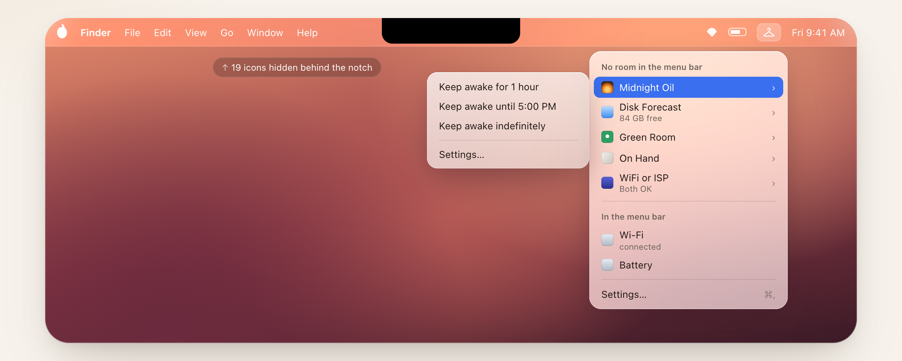

# Coat Check

A free, open-source menu bar manager for macOS. When the notch or a crowded menu bar leaves no room, macOS quietly hides icons. Coat Check puts every one of them a click away.

<p align="center">
  
</p>

- **Every icon, within reach.** Click the hanger to see all your menu bar icons, with the ones macOS had no room for at the top.
- **Their real menus, right under the hanger.** For apps with a menu, Coat Check shows that menu as a submenu and clicks the item you choose for you.
- **Nothing moves.** Coat Check doesn't rearrange your menu bar or drag icons around.
- **No telemetry.** Nothing leaves your Mac except Sparkle's update check.

## Install

Download the DMG from [coatcheckformac.com](https://coatcheckformac.com) or the [latest release](https://github.com/coreyhaines31/coatcheck/releases/latest), or use Homebrew:

```sh
brew install coreyhaines31/tap/coatcheck
```

Needs an Apple silicon Mac. Tested on macOS 14 Sonoma through 26 Tahoe; macOS 27 support is being tested in [#24](https://github.com/coreyhaines31/coatcheck/issues/24). Coat Check updates itself.

## How to use it

Coat Check adds a hanger to the right end of your menu bar. Click it:

- **No room in the menu bar** lists the icons macOS is hiding, usually behind the notch. Hover one with a ▸ to see its menu, and choose an item.
- **In the menu bar** lists the icons you can already see.
- Icons without a ▸ (some apps show a panel instead of a menu) open where macOS put them.

Coat Check needs **Accessibility** permission to list other apps' menu bar icons and click them. It reads nothing else. The first time you click the hanger, choose **Allow Accessibility Access…**, or turn it on in System Settings → Privacy & Security → Accessibility.

If the hanger itself ever ends up hidden, open Coat Check again from Finder or Spotlight and its settings window appears.

### Optional: hide icons with a divider

Turn on **Hide icons with a divider** in Settings to add a thin divider (│) left of the hanger. Icons to its left can be hidden to clear space: hold ⌘ and drag icons across it. With the divider on, you can also:

- **Hide them on the laptop screen**: hide them when the built-in display is the only one, and show them again when an external display connects.
- **Hide them again** a few seconds after you show them.

## Command line

Install the `coatcheck` command from Settings → Command line → **Install…**.

```
coatcheck list            Every menu bar icon, with the ones macOS had no room for marked hidden
coatcheck click <name>    Open a menu bar icon, even one macOS had no room for
coatcheck status          Whether the divider is hiding icons, and whether only the laptop screen is in use
coatcheck hide|show|toggle  Hide or show the icons left of the divider
coatcheck open            Open Coat Check, or its settings if it's already running
```

Add `--json` for machine-readable output. `<name>` is an app name from `coatcheck list` (any case; the start of a name works when it's unique), or `"App: label"` when an app has several icons.

## How it works

Accessibility lists each running app's menu bar icons with their names and positions, which also works on macOS 26, where the window list reports every icon as Control Center's. An icon is hidden when it sits left of the notch, or left of the end of the app menus on screens without one. Most apps expose their icon's menu through Accessibility even while it's closed, so Coat Check rebuilds that menu under the hanger and presses the real item when you choose it.

## Building

Needs macOS 14 or later and Xcode.

```sh
make test    # unit tests
make lint    # SwiftLint
make run     # build dist/CoatCheck.app and open it
```

Set `CODESIGN_IDENTITY` to a signing identity when building locally, so the Accessibility permission survives rebuilds. Releases are built with `scripts/release.sh` from `main`: Developer ID signing, notarization, a DMG and a Sparkle appcast.

## License

MIT. Coat Check is written from scratch. It shares no code with Ice, Thaw or other GPL-licensed menu bar managers.
